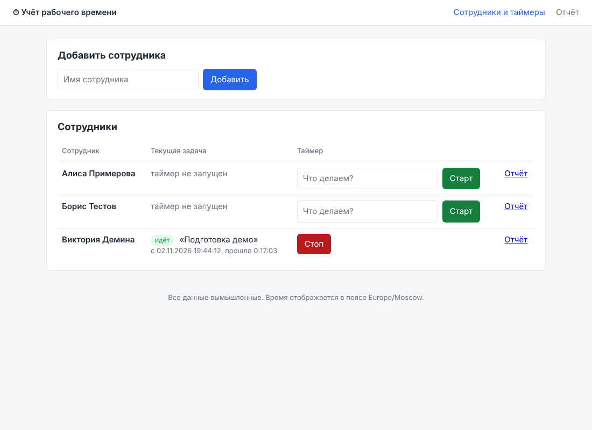
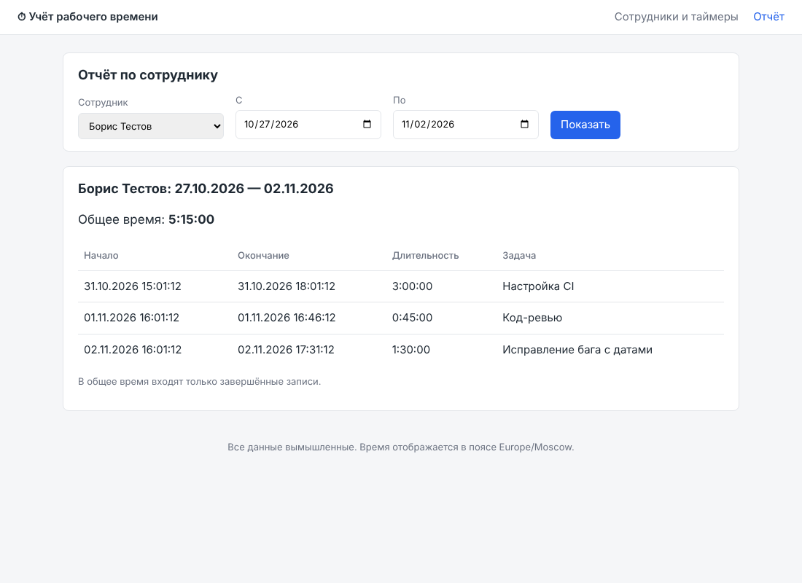

# Учёт рабочего времени

Небольшое веб-приложение для учёта рабочего времени сотрудников: список сотрудников,
таймер с описанием задачи, отчёт за выбранный период. Данные хранятся в SQLite и
переживают перезапуск. Авторизации и ролей нет, все данные вымышленные.

| Сотрудники и таймеры | Отчёт за период |
|---|---|
|  |  |

На телефоне строки таблицы складываются в карточки: [docs/index-mobile.png](docs/index-mobile.png).

## Что умеет

- добавление сотрудников (имя уникально без учёта регистра, в том числе для кириллицы);
- запуск таймера с описанием задачи и его остановка; у сотрудника может идти только
  один таймер, повторный «Старт» отклоняется с понятным сообщением;
- отчёт по сотруднику за период (обе даты включительно): список записей и общее время;
  для идущего таймера показывается текущая длительность, но в итог она не входит;
- сохранение данных после перезапуска (файл SQLite);
- демо-данные одной командой.

## Стек

- Python 3.11+ (используются `zoneinfo` и `datetime.UTC`);
- [Flask](https://flask.palletsprojects.com/) 3 — маршруты и шаблоны Jinja2, HTML рендерится на сервере;
- SQLite через стандартный модуль `sqlite3`, без ORM;
- pytest для тестов, ruff для линтера.

Зависимостей намеренно минимум: приложение запускается двумя командами и целиком
помещается в несколько файлов.

## Запуск

```bash
cd time_tracker
python -m venv .venv
source .venv/bin/activate          # Windows: .venv\Scripts\activate
pip install -r requirements.txt

python -m timetracker.seed         # необязательно: три сотрудника и записи за последние дни
python -m timetracker              # http://127.0.0.1:5000
```

База по умолчанию создаётся в `time_tracker/instance/timetracker.sqlite3`
(каталог в `.gitignore`). Схема создаётся автоматически при старте.

Настройки через переменные окружения (все необязательные):

| Переменная | По умолчанию | Назначение |
|---|---|---|
| `TIMETRACKER_DB` | `instance/timetracker.sqlite3` | путь к файлу базы |
| `TIMETRACKER_TZ` | `UTC` | часовой пояс для отображения времени и границ периода в отчёте, например `Europe/Moscow` |
| `TIMETRACKER_HOST` / `TIMETRACKER_PORT` | `127.0.0.1` / `5000` | адрес и порт |
| `TIMETRACKER_SECRET_KEY` | случайный на каждый запуск | ключ подписи сессии (нужен только для всплывающих сообщений) |
| `TIMETRACKER_DEBUG` | выключен | `1` включает отладчик Flask |

Пример: `TIMETRACKER_TZ=Europe/Moscow python -m timetracker`.

Встроенный сервер Flask подходит для демо и разработки; для постоянной работы
поставьте перед приложением WSGI-сервер, например `waitress-serve --call timetracker:create_app`.

## Проверки

```bash
cd time_tracker
pytest            # 64 теста, меньше секунды
ruff check . && ruff format --check .
```

Тесты разделены на три файла:

- `tests/test_services.py` — бизнес-логика без веб-слоя (временная база на каждый тест);
- `tests/test_routes.py` — HTTP-сценарии через тестовый клиент Flask;
- `tests/test_app_config.py` — конфигурация, демо-данные, экранирование HTML.

Покрытые сценарии, в том числе обязательные из задания:

| Сценарий | Где проверяется |
|---|---|
| добавление сотрудника, пустое имя, дубликат (включая `Борис` / `борис`) | `test_add_employee_*`, `test_add_duplicate_employee_returns_409` |
| запуск таймера, запуск без описания, неизвестный сотрудник | `test_start_timer_*` |
| **повторный запуск** при идущем таймере: ошибка 409, вторая открытая запись не создаётся, индекс в базе запрещает её даже в обход кода | `test_start_timer_twice_is_rejected`, `test_start_timer_twice_returns_409_and_keeps_single_entry`, `test_database_forbids_second_running_entry_even_bypassing_service` |
| остановка, остановка без идущего таймера, повторный старт после остановки | `test_stop_timer_*`, `test_restart_after_stop_is_allowed` |
| независимость таймеров разных сотрудников | `test_timers_of_different_employees_are_independent` |
| **пустой отчёт**: нет записей вообще или все вне периода, итог `0:00:00`, сообщение на странице | `test_report_is_empty_*`, `test_empty_report` |
| отчёт с записями: фильтр по периоду, сумма, границы дня в часовом поясе приложения | `test_report_counts_only_entries_within_period`, `test_report_period_boundaries_in_app_timezone`, `test_report_with_entries_shows_rows_and_total` |
| идущий таймер в отчёте показан, но не учтён в итоге | `test_report_shows_running_entry_but_excludes_it_from_total` |
| некорректный ввод: даты не в ISO, начало позже конца, экстремальные даты, огромный id | `test_report_with_*_returns_400`, `test_huge_employee_id_returns_404` |
| **сохранение данных после перезапуска**: повторное открытие базы и повторное создание приложения | `test_data_survive_reconnect`, `test_data_survive_app_restart` |
| экранирование пользовательского ввода в HTML | `test_user_input_is_html_escaped` |

GitHub Actions (`.github/workflows/time-tracker.yml`) прогоняет линтер и тесты на Python 3.11–3.13.

## Как устроено

```
time_tracker/
├── timetracker/
│   ├── __init__.py      фабрика приложения create_app(), настройки
│   ├── __main__.py      python -m timetracker
│   ├── db.py            схема SQLite, соединение на запрос
│   ├── services.py      вся бизнес-логика: сотрудники, таймер, отчёт
│   ├── routes.py        HTTP-маршруты и фильтры шаблонов
│   ├── seed.py          демо-данные
│   ├── templates/       base.html, index.html, report.html
│   └── static/style.css
├── tests/
├── docs/                скриншоты
├── requirements.txt
└── pyproject.toml       настройки pytest и ruff
```

Две таблицы: `employees (id, name, name_key, created_at)` и
`time_entries (id, employee_id, description, started_at, stopped_at)`. Идущий таймер —
запись с `stopped_at IS NULL`.

Решения, которые стоит знать:

- **Логика отделена от Flask.** Функции в `services.py` принимают соединение `sqlite3`
  и бросают типизированные ошибки (`TimerAlreadyRunningError`, `NotFoundError` и т. д.),
  у каждой свой HTTP-код. Маршруты только разбирают запрос и рендерят шаблон.
- **Один идущий таймер на сотрудника** гарантируется дважды: проверкой в коде (чтобы дать
  понятное сообщение с названием текущей задачи) и частичным уникальным индексом
  `ON time_entries(employee_id) WHERE stopped_at IS NULL` — он закрывает гонку, когда два
  запроса на запуск приходят одновременно.
- **Время хранится в UTC** строками ISO-8601 с точностью до секунды и единым форматом
  (`2026-11-02T16:38:00+00:00`). SQLite сравнивает такие строки как текст, поэтому формат
  должен быть строго одинаковым — иначе `>=`/`<` в запросах ломаются. Отображение и границы
  дней в отчёте — в поясе `TIMETRACKER_TZ`.
- **Период отчёта — календарные дни включительно.** Запись попадает в отчёт по моменту
  начала: `started_at >= начало date_from` и `started_at < начало следующего дня после date_to`.
- **Итог отчёта считает только завершённые записи**, идущий таймер показан отдельно,
  чтобы отчёт не менялся каждую секунду.
- **Ошибки форм** возвращают страницу с сообщением и кодом 400/404/409 и сохраняют
  введённый текст; успешные действия делают redirect (303), чтобы обновление страницы
  не повторяло POST.

## Использованные ИИ-инструменты и модели

- **Claude Code** (агент Anthropic для работы с кодом) в облачной сессии claude.ai/code,
  подключённой к этому репозиторию. Агент сам планировал, писал код и тесты, запускал их,
  поднимал приложение, проверял его в браузере и коммитил результат на отдельную ветку.
- **Модель: Claude Fable 5.1** (`claude-fable-5-1`) — одна и та же модель для основной сессии
  и для под-агентов ревью.
- Внутри сессии использовались: встроенная команда Claude Code `/code-review` (независимое
  ревью кода под-агентами), headless Chromium + Playwright для прохода по интерфейсу и
  скриншотов, `ruff` для линтера и форматирования.

Весь код в каталоге написан ИИ по промптам; человек ставил задачу, принимал решения по
спорным местам и проверял результат.

## Примеры запросов к ИИ

1. Исходный промпт — текст задания целиком:
   > Создайте с нуля небольшое веб-приложение для учёта рабочего времени сотрудников…
   > Добавьте проверки основных сценариев, включая повторный запуск таймера и пустой отчёт.
2. > Прежде чем делать уникальность имён через `COLLATE NOCASE`, проверь, как SQLite
   > сравнивает кириллицу без учёта регистра. Если не умеет — предложи вариант.
3. > Напиши тесты на повторный запуск таймера: второй «Старт» при идущем таймере должен
   > вернуть 409 и не создать вторую открытую запись. И на пустой отчёт: итог `0:00:00`
   > и сообщение «Нет записей за выбранный период».
4. > Границы периода в отчёте бери в часовом поясе приложения, а в базе храни UTC.
   > Добавь тест на записи в 23:59:59 и 00:00:00 по Москве, чтобы поймать сдвиг на день.
5. > Запусти приложение с демо-данными, пройди сценарии в headless-браузере
   > (добавить сотрудника, старт, отчёт, пустой отчёт) и сними скриншоты, в том числе
   > на ширине 390px.
6. > Проведи ревью кода на средней глубине: ищи ошибки, которые приводят к 500
   > или потере данных, и предложи минимальные исправления.

## Найденные и исправленные ошибки

Все 54 исходных теста прошли с первого запуска, поэтому ошибки искались другими
способами: проверкой поведения библиотек до написания кода, прогоном в браузере,
линтером и независимым ревью. Что нашлось и как исправлено:

| # | Ошибка | Как нашли | Исправление |
|---|---|---|---|
| 1 | SQLite без ICU не приводит кириллицу к нижнему регистру: `lower('ИВАН')` возвращает `ИВАН`, а `'ИВАН' = 'иван' COLLATE NOCASE` даёт 0. Уникальность имён через `NOCASE` пропускала бы дубли вроде «Борис»/«борис». | запрос к ИИ № 2, проверено в `sqlite3` до написания кода | колонка `name_key` с `casefold()`-версией имени, уникальность по ней; тест `test_add_employee_duplicate_is_case_insensitive_for_cyrillic` |
| 2 | На ширине телефона страница уезжала по горизонтали: ширина документа 458px при экране 390px (таблица с формами не помещалась). | Playwright, `document.documentElement.scrollWidth` | таблица обёрнута в `.table-wrap { overflow-x: auto }`, на узком экране снят `white-space: nowrap`; после фикса ширина 390px |
| 3 | Тест отчёта с идущим таймером брал «сегодня» через `date.today()` (системный пояс), а приложение в тестах работает в `Europe/Moscow` — около полуночи тест бы падал. | ревью тестов | дата берётся из пояса приложения |
| 4 | Демо-данные строились от полуночи UTC с фиксированным часом начала: при запуске утром часть записей оказывалась «в будущем». | ревью `seed.py` | все моменты отсчитываются назад от текущего времени; тест проверяет, что записей в будущем нет |
| 5 | `GET /report?date_from=0001-01-01` или `date_to=9999-12-31` вызывал необработанный `OverflowError` при переводе в UTC — ответ 500. | `/code-review` | `OverflowError` переводится в `ValidationError` (400); тесты на оба края |
| 6 | `employee_id=10**20` в URL проходил конвертер `<int:>`, а `sqlite3` падал с `OverflowError` — ответ 500 вместо 404. | `/code-review` | проверка диапазона int64 в `get_employee`, ответ 404 |
| 7 | `TIMETRACKER_DB=:memory:` приводил к `no such table` на каждом запросе: у каждого запроса своё соединение, а база в памяти живёт внутри одного. | `/code-review` | понятная ошибка при старте приложения; тест |
| 8 | Не был объявлен `requires-python`, хотя код использует `datetime.UTC` (3.11+): на 3.10 падение при импорте. | `/code-review` | `requires-python = ">=3.11"` в `pyproject.toml`, матрица CI 3.11–3.13 |
| 9 | При ошибке формы (дубликат, слишком длинное описание) введённый текст терялся. | `/code-review` | значения возвращаются в поля; тест `test_form_values_are_kept_after_error` |
| 10 | Фиксированный `SECRET_KEY` по умолчанию позволял подделать cookie сессии. | `/code-review` | без переменной окружения ключ генерируется случайно при старте |
| 11 | Преобразование строки базы в `TimeEntry` дублировалось в двух местах; `/report` строил полные статусы с JOIN ради списка имён. | `/code-review` | единый `_row_to_entry`, отдельный `all_employees()` |
| 12 | Несортированные импорты и длинные строки. | `ruff` | автоисправление, конфиг в `pyproject.toml` |

Отдельно — риски, закрытые заранее при проектировании (тесты на них есть):
гонка двух одновременных «Старт» (частичный уникальный индекс), сравнение дат как строк
(единый формат без микросекунд, тест `test_timestamps_are_stored_in_utc_without_microseconds`),
сдвиг на день на границах периода (тест с 23:59:59 и 00:00:00 по Москве), отрицательная
длительность при переводе системных часов назад (`stopped_at` не меньше `started_at`).

## Ограничения и что можно доработать

- Нет защиты от CSRF: в задании нет пользователей и авторизации, поэтому подделка запроса
  «от имени» кого-то не имеет смысла; при добавлении логина нужно подключить токен
  (например, Flask-WTF `CSRFProtect`).
- Записи нельзя редактировать и удалять, нет пагинации — для демо-объёма данных не нужно.
- Один идущий таймер на сотрудника — осознанное решение; при желании «Старт» мог бы
  автоматически закрывать предыдущую задачу.
- Для продакшена нужен WSGI-сервер и резервное копирование файла базы.
